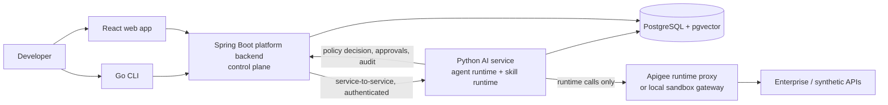

# Architecture Overview

> Status markers: **Implemented** = code + tests in this repository; **Planned** = designed,
> not yet built; **Blocked** = designed, cannot be built/verified in the current environment
> (see `docs/implementation/STATUS.md`).

## System context



## Service boundaries

| Service | Owns | Does not own | Status |
|---|---|---|---|
| **Go CLI** (`apps/cli`) | Developer commands, local config, token storage, text rendering of UI components (`--json` for raw) | Any business logic; never calls the AI service or gateways directly | Implemented (standard library only, ADR-0009) |
| **React app** (`apps/frontend`) | Chat with live run progress (SSE), generative-UI components, clarification and approval panels, run history | Fabricated data — unavailable features are labelled | Implemented; lint, type-check, Vitest and build run |
| **Spring Boot platform** (`apps/backend`) | Authentication (dev tokens locally, OIDC-ready), tenant/role context, **who may approve**, approval tokens and decisions, audit log (PostgreSQL + Flyway), relaying runs/SSE to the agent with short-lived service tokens | Model calls, retrieval, planning, run state | Implemented (ADR-0012); the contract suite passes against it |
| **Python AI service** (`ai/`, `skills/`) | LLM intent/planning/response behind code guardrails, run + conversation state, skill runtime (**policy enforcement point**), retrieval, model concurrency limiter, evaluation instrumentation | Final authorization of approvals, approval records of record | Implemented; LangGraph adapter Blocked (PyPI) |
| **Sandbox gateway** (`sandbox/`) | Synthetic Payments API with OAuth2 client-credentials, scopes, idempotency, tenant isolation and fault injection | Anything real | Implemented |
| **Evaluation** (`evals/`) | Versioned datasets, deterministic evaluators, runner, reports | Production traffic | Implemented (offline) |

## Canonical code layout (Python)

```
ai/
  agent/        intent classification, planner, bounded orchestrator, typed run state
  knowledge/    document model + stable IDs, OpenAPI/Markdown ingestion, BM25,
                hashing embedder, RRF hybrid retrieval, context assembly, grounded answers
  models/       ModelProvider interface, deterministic offline provider, usage accounting
  telemetry.py  span/attribute helpers (gen_ai.* names in one place)
skills/
  runtime/      skill contracts, registry, policy (PEP + local PDP), approvals,
                idempotency, audit, outbound HTTP safety, redaction, runtime
  api/          discovery, describe, execute (via gateway adapter), sdk_generator
  jwt/          token inspection (no verification claims, no secret echo)
  docs/         documentation search with citations
  builtin.py    registers built-in skills
  mcp_server.py MCP adapter — every tool call goes through the runtime
sandbox/        synthetic gateway app, OpenAPI spec, synthetic docs
evals/          datasets/, evaluators, metrics, runner, reports
tests/          unit/ and integration/ suites
```

The agent path in detail: `ai/agent/` has the orchestrator, the LLM intent classifier
(`intent_llm`), the intent resolver (built from each skill's declared `intents`), the LLM step
planner (`planner_llm`), grounding (`grounding`), conversation memory (`conversations`) and
the component registry (`ui`, with its manifest in `contracts/json-schema/ui-components.json`).
`ai/models/` has the provider interface, the mlx-lm and Anthropic adapters, the secret
sanitizer (`generate_structured`), call observation (`observe`) and the concurrency limiter
(`limiter`).

Legacy trees `agents/` and the hyphenated `skills/*-*` directories were removed
(ADR-0005); they had no callers outside the Makefile and CI.

## Request flow

```mermaid
sequenceDiagram
  participant U as User (web / CLI)
  participant P as Platform (Spring or Python facade)
  participant A as Agent service
  participant M as LLM (mlx-lm)
  participant S as Skill runtime
  U->>P: POST /api/v1/runs (token, query, conversation_id?)
  P->>A: service token carrying the verified principal
  A->>M: intent + entities (secrets masked, history as untrusted context)
  A->>A: ground entities in what the user typed; resolve allowed skills
  loop bounded ReAct loop
    A->>M: next step (observations as untrusted context)
    M-->>A: skill + arguments (a proposal)
    A->>A: validate: allowed, described first, grounded, not a repeat
    A->>S: invoke (policy, environment, approval, idempotency, audit)
  end
  S-->>A: needs approval (action hash)
  A-->>P: AWAITING_APPROVAL
  P-->>U: run + approval panel
  U->>P: approve(action_hash) as an approver
  P->>A: resume with an action-bound approval token
  A->>M: reply + UI choices
  A-->>P: run (COMPLETED)
```

1. The client sends the request; the platform authenticates it and derives tenant and roles
   from the verified token only.
2. The agent classifies the intent with the LLM, grounds the extracted entities against the
   user's own words, and asks the intent resolver which skills that intent may use.
3. A bounded loop lets the LLM pick one skill call per turn. The orchestrator validates every
   decision before the skill runtime sees it; the runtime enforces policy, environment
   allowlist, approvals and idempotency and writes a redacted audit record.
4. A missing required value stops the run in `NEEDS_CLARIFICATION` with the blocked call
   checkpointed; the user's answer (`/clarify` or a plain next message in the conversation)
   re-grounds it. A write stops in `AWAITING_APPROVAL`; an approver approves the *exact*
   action hash; the platform mints the token and the run resumes.
5. The LLM writes the reply and picks components from the registry; the server builds all
   props from real step output and validates them against each component's schema.
6. Progress is observable: `POST /runs?mode=async` returns 202 and `GET /runs/{id}/events`
   streams the timeline over SSE (resumable with `Last-Event-ID`). Model calls are limited
   (default one at a time for mlx-lm) with a tenant-fair queue; a full queue is `429` +
   `Retry-After`.

If the model fails the run fails explicitly (`FAILED`), except after an executed write: then
the run is `COMPLETED`, says the action succeeded and the summary is unavailable
(`summary_unavailable` event), because `FAILED` would invite a duplicate retry.

## Data ownership

- Platform tables (`platform_approval_decisions`, `platform_audit_log`) — Flyway migrations in `apps/backend`. Run state, conversations, single-use approvals and idempotency records live in the agent service's store (`COPILOT_STATE_DB`, ADR-0010).
- `knowledge` schema — owned by the AI service (`ai/knowledge/sql/`): documents, chunks,
  embeddings, full-text vectors.
- No service reads another service's schema directly (ADR-0007).
